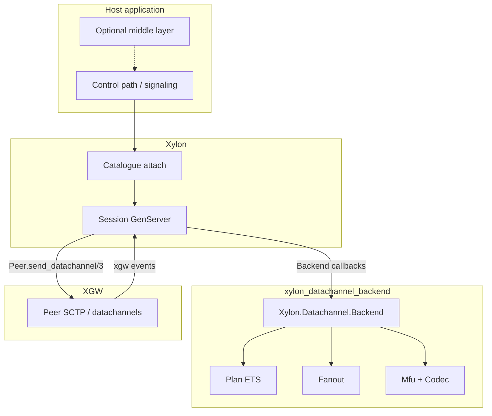
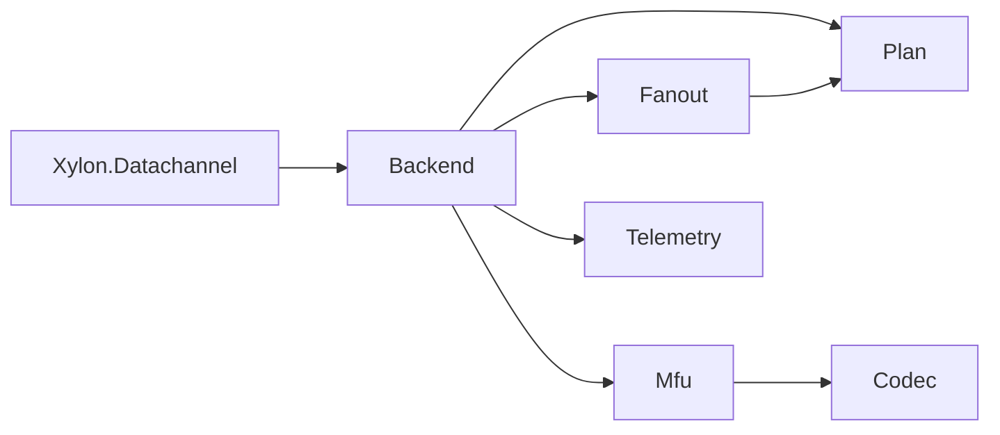
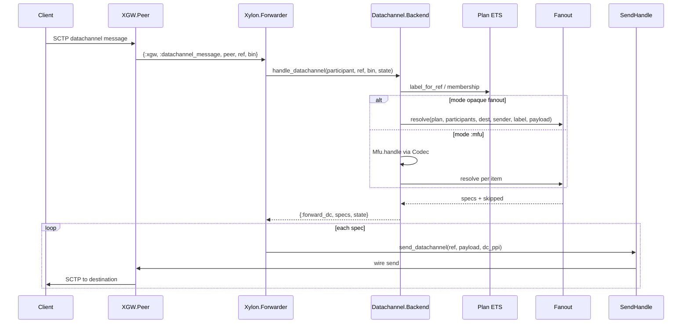
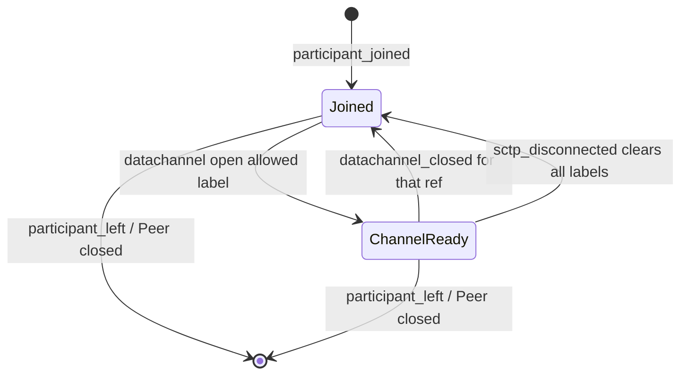
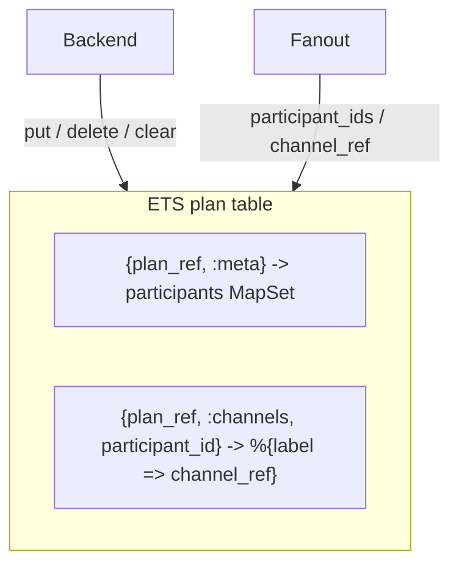
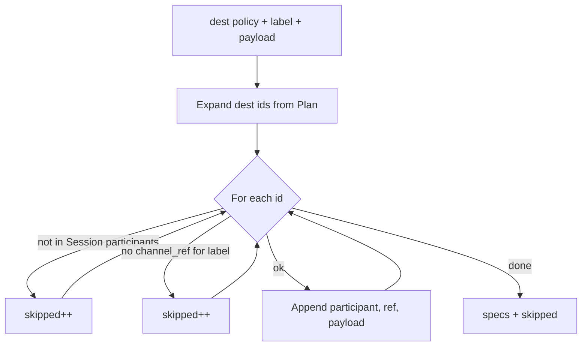
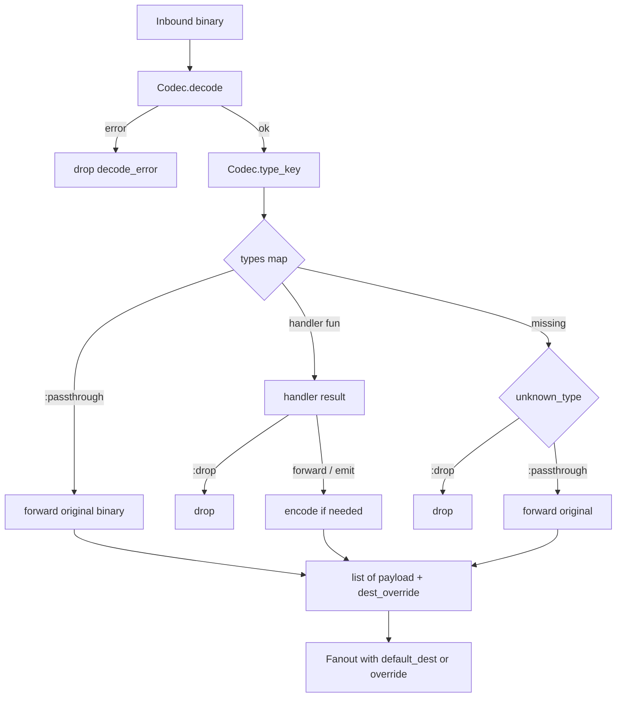

# Architecture -- xylon_datachannel_backend

Media-path library for [Xylon](https://github.com/Lazarus404/xylon): one catalogue
Backend (`:datachannel`) that fans out WebRTC datachannel payloads and optionally
demuxes typed messages (MFU). Transport and DTLS/SCTP stay in
[XGW](https://github.com/Lazarus404/xgw). Session lifecycle and Peer I/O stay in
Xylon. This package owns **membership**, **label isolation**, **fanout policy**,
and **typed demux**.

Host apps may add an optional middle layer (auth, REST inject, presence, history)
on top of Xylon Control; this package does not require it.

---

## 1. Role in the stack



| Layer | Owns |
| --- | --- |
| Host / optional middle layer | Auth, REST inject, presence, history, topics/ACL, webhooks |
| Xylon Session | Participant map, Peer refs, XGW event dispatch, outbound send |
| This library | Plan membership, label -> channel_ref, mode / MFU, `{:forward_dc, specs, state}` |
| XGW Peer | ICE/DTLS/SCTP, open/close/message events, wire send |

**In scope:** opaque relay and typed demux on plaintext datachannel binaries.

**Out of scope:** IdP, multi-tenant SaaS APIs, RTP/RTCP policy, inventing datachannel
labels the client never opened.

Rule of thumb: if it must run on every inbound DC message with low latency, it
belongs here (or in a handler this package invokes). If it needs a DB or a
"user" notion beyond participant id, put it in the host or middle layer.

---

## 2. Module map

| Module | Responsibility |
| --- | --- |
| `Xylon.Datachannel` | Public facade: `id/0`, `attach/0`, `publish/4` |
| `Xylon.Datachannel.Backend` | `Xylon.Backend` implementation; catalogue id `:datachannel`; `forward_plan/2` |
| `Xylon.Datachannel.Plan` | ETS membership + per-participant label -> `channel_ref` |
| `Xylon.Datachannel.EgressRoute` | ETS per-sender default dest (`:_` or label-scoped) |
| `Xylon.Datachannel.Fanout` | Resolve dest policy to `{participant, channel_ref, payload}` specs |
| `Xylon.Datachannel.Mfu` | Decode -> type key -> handler / passthrough / drop |
| `Xylon.Datachannel.Codec` | Behaviour: `decode/1`, `encode/1`, `type_key/1` |
| `Xylon.Datachannel.Codec.JSON` | Default codec; type is the `"type"` / `:type` field |
| `Xylon.Datachannel.Codec.Msgpack` | MessagePack codec; same `"type"` key; sets `dc_ppi: :binary` |
| `Xylon.Datachannel.Codec.Cbor` | CBOR codec; same `"type"` key; sets `dc_ppi: :binary` |
| `Xylon.Datachannel.Telemetry` | `:telemetry.execute([:xylon, :dc, event], ...)` |



---

## 3. Attach and Session create

At host startup, register the Backend once:

```elixir
:ok = Xylon.Datachannel.attach()
# equivalent: Xylon.attach(Xylon.Datachannel.Backend)
```

Create a Session with catalogue id `:datachannel` and mode opts:

```elixir
{:ok, session} =
  Xylon.Session.create(tenant_id, session_id, :datachannel,
    mode: :fanout_except_sender,
    labels: :any,
    max_message_bytes: 65_535
  )
```

`Backend.init/2` allocates a Plan ref (`Plan.new/1` with the Session pid when
present, else `Plan.new/0`) so Session and Forwarder share one ETS graph.
Session and Forwarder each call `init/2` and keep a separate `backend_state`
map; both use the same `plan_ref`. Plan ETS is the source of truth for
membership and label -> channel_ref maps. Session passes the same create
keyword opts into `Forwarder.start_link/1` so message-path mode/labels/tap
match Session. Participants enter via Xylon join; the Backend records them
with `Plan.put_participant/2` (full `Participant` in ETS) for Fanout across
both processes. `Backend.forward_plan/2` installs a Forwarder row with
`mode: :datachannel`.

---

## 4. Modes

Configured per Session (`:mode` opt). Not a second catalogue attach.

| Mode | Behavior |
| --- | --- |
| `:fanout_all` | Send inbound bytes to every participant with a matching open label |
| `:fanout_except_sender` | Same, excluding the sender (**default**) |
| `:fanout_subset` | Send to `opts[:subset]` participant ids only |
| `:mfu` | Run MFU, then fanout using `:default_dest` (or per-handler override) |

Opaque modes never decode. MFU always fans out afterward; it does not replace
destination policy.

`Xylon.Datachannel.publish/4` targets `:all` or an explicit id list (server inject),
independent of Session mode, and still requires an open matching label on each
destination.

### Subset ownership

`:fanout_subset` and subset overrides take **participant ids only**. Role or
attribute filters are resolved by the host (or middle layer) into an id list
before they reach this library.

---

## 5. Inbound message path

XGW delivers datachannel messages to the Session's **Forwarder** (Peer
`handler:`), not the Session GenServer mailbox. The Forwarder looks up the
participant from its plan ETS row, calls `handle_datachannel/4`, and on
`{:forward_dc, specs, state}` sends each spec through
`XGW.Peer.SendHandle.send_datachannel/4` (fallback
`Peer.send_datachannel_async/4`) using `dc_ppi` from backend state.

Channel open/close and SCTP disconnect are relayed to Session, which calls the
matching Backend callbacks. Server `publish/4` runs on the Session GenServer
path (`publish_datachannel/4` then Session egress).



Hot-path checks in the Backend (before fanout):

1. `byte_size(data) <= max_message_bytes` (else drop + telemetry)
2. `channel_ref` maps to a known label in Plan (else drop)
3. Optional rate limit
4. Resolve dest: MFU `dest_override` if present; else decode map via Jason or
   Session `codec.decode/1`, then `Envelope.dest_ids/1` (ids -> use; map/filter ->
   drop `:bad_dest`; omit -> `EgressRoute.get/3` then Session default); intersect
   id lists with live Plan (empty -> drop `:empty_dest`, or `:empty_route` when
   the empty list came from an egress row)
5. `authorize` with `%{dir: :send, label, dest_ids, sender_id}` (else drop)
6. `Fanout.resolve/6` label isolation + skip/buffer missing channels

Opaque undecodable payloads skip client-`to` and use egress map then Session
default dest. Optional `tap` hooks must stay cheap.

### Egress routes (per-sender defaults)

Key: `{plan_ref, sender_id, label | :_}` -> `:all` | `:except_sender` | `[ids]`.

Lookup: label-specific row, then `:_`. Host APIs:
`Xylon.Datachannel.set_route/4`, `clear_route/3`, Control
`PUT/DELETE/GET .../routes`. Empty id list keeps the row and drops inbound until
clear. Leave clears the sender's rows and prunes that id from other id-list
dests; terminate clears the plan. `set_route` requires the sender in Plan. No
AOI grid here -- apps compute id lists.

Missing open channel on a destination: default **skip** that Peer
(`on_no_channel: :skip`) and emit `:skip_no_channel`. Optional `:buffer` queues
up to 8 payloads per `(dest, label)` for 5s (drop-oldest / TTL) and flushes on
channel open via `{:forward_dc, specs, state}` from `handle_datachannel_open/3`.
Buffered destinations do not emit `:skip_no_channel`. Do not block waiting for open.

---

## 6. Channel lifecycle

Eligibility for fanout on label `L`:

1. Participant is in the Session / Plan membership, and
2. A datachannel for `L` is open (Plan has label -> `channel_ref`)



| XGW event (to Session) | Backend callback | Plan effect |
| --- | --- | --- |
| `{:xgw, :datachannel, peer, %{ref, label, id}}` | `handle_datachannel_open/3` | `put_channel` if label allowed |
| `{:xgw, :datachannel_closed, peer, ref}` | `handle_datachannel_closed/3` | `delete_channel` |
| `{:xgw, :sctp_disconnected, peer}` | `handle_sctp_disconnected/2` | `clear_channels` (membership kept) |
| `{:xgw, :closed, peer, reason}` | `participant_left/2` | `delete_participant` |

Label allow-list: `labels: :any` or an explicit list of binaries. Disallowed opens
are ignored (not recorded).

---

## 7. Plan (ETS)

`Plan` is a named public ETS table keyed by `plan_ref` (one per Backend init /
Session). Multiple Sessions do not collide.



Public operations:

- `new/0`, `delete/1`
- `put_participant/2`, `delete_participant/2`
- `put_channel/4`, `delete_channel/3`, `clear_channels/2`
- `participant_ids/1`, `channel_ref/3`, `label_for_ref/3`

Session still owns the authoritative `%{id => Participant}` struct map (with
Peer refs) used for Session lifecycle. Plan owns **who is eligible for fanout**
and **which channel_ref to use per label**; `Fanout.resolve/6` reads Plan only.

---

## 8. Fanout resolution

`Fanout.resolve/6` turns a dest policy into specs:

```text
dest_policy =
  :all | :except_sender | [participant_id]

spec = {participant, channel_ref, payload}
```



**Label isolation:** a message received (or published) on label `L` is sent only
on each destination's open channel for `L`. It never spills onto another label.

---

## 9. MFU (typed demux)

MFU is application-level demux, not media mixing.



Handler results (via `Mfu`):

- `:drop`
- `{:forward, binary | term}` (term re-encoded)
- `{:emit, [binary | term]}`
- Same forms with a dest override: `:all`, `:except_sender`, or `[id]`

Default type registry entries are either `:passthrough` or a function.
`unknown_type` defaults to `:drop`.

JSON and MessagePack / CBOR codec type key: map field `"type"` or `:type`.

---

## 10. Server publish (inject)

Hosts (or a middle layer) inject without a client sender:

```elixir
:ok = Xylon.Datachannel.publish(session, payload, :all, label: "chat")
:ok = Xylon.Datachannel.publish(session, payload, ["p1", "p2"], label: "chat")
```

Flow: `publish/4` -> `Session.publish_datachannel/4` ->
`Backend.publish_datachannel/4` -> Fanout -> `{:forward_dc, specs, state}` ->
Peer sends.

Optional `authorize` callback runs on the publish path. Size limits apply the
same as inbound.

---

## 11. Session opts (Backend)

| Opt | Default | Meaning |
| --- | --- | --- |
| `:mode` | `:fanout_except_sender` | See section 4 |
| `:default_dest` | `:except_sender` | MFU default dest policy |
| `:subset` | `[]` | Ids when mode is `:fanout_subset` |
| `:labels` | `:any` | Allow-list for open registration |
| `:codec` | `Xylon.Datachannel.Codec.JSON` | MFU codec module (`Codec.Msgpack` / `Codec.Cbor` for binary PPI) |
| `:label_codecs` | `%{}` | Per-label codec override (`"json"` / `"msgpack"` / `"cbor"` or modules); missing label uses `:codec` |
| `:dc_ppi` | `:string` (or `:binary` when Msgpack/CBOR) | Set by Backend.init; Forwarder/Session pass to Peer send |
| `:types` | `%{}` | MFU type -> `:passthrough` \| fun |
| `:unknown_type` | `:drop` | MFU policy for unknown types |
| `:max_message_bytes` | `65_535` | Inbound and publish ceiling |
| `:on_no_channel` | `:skip` | `:skip` \| `:buffer` (bounded late-open queue) |
| `:rate_limit` | `nil` | `nil` \| `{:token_bucket, max_per_sec, burst}` |
| `:default_label` | `"data"` | Publish label when opts omit `:label` |
| `:authorize` | `nil` | `(meta -> boolean)` on publish |
| `:tap` | `nil` | `(event -> any)` observe hook; errors swallowed |
| `:rpc_router` | `false` | Merge RpcRouter MFU types when true |
| `:state_coalesce` | `false` | Drop stale state seq when true |
| `:server_open_labels` | `[]` | Opt-in labels to open via `Peer.open_datachannel/2` after SCTP connect |

---

## 12. Telemetry

Events under `[:xylon, :dc, event]` with measurements and metadata
`%{tenant_id, session_id, mode, ...}`:

| Event | Typical meaning |
| --- | --- |
| `:in` | Inbound message accepted |
| `:out` | Forward specs produced |
| `:fanout_size` | Spec count |
| `:skip_no_channel` | Destinations skipped (no matching open label) |
| `:drop` | Rejected (size, unknown channel, decode, handler, ...) |
| `:route` | Egress route set/clear (`meta.action` `:set` / `:clear`) |
| `:egress_drop` | Outbound DC send failed (congested / bad ref); Forwarder drop policy |

Drop reason tags include `:size`, `:unknown_channel`, `:decode_error`,
`:handler_drop`, `:unknown_type`, `:rate_limit`, `:buffer_overflow`,
`:buffer_ttl`, `:empty_dest`, `:empty_route` (egress id list empty after Plan
intersect), and related encode/handler failures.

### Grafana-friendly panel sketch

Subscribe with `:telemetry.attach/4` (or PromEx / TelemetryMetrics) on
`[:xylon, :dc, event]`. Suggested panels:

| Panel | Event | Aggregation |
| --- | --- | --- |
| Inbound rate | `:in` | rate of `bytes` / message count |
| Outbound specs | `:out` | rate of `count` |
| Fanout width | `:fanout_size` | avg / p95 of `count` per message |
| Skip no channel | `:skip_no_channel` | rate of `count` |
| Drops by reason | `:drop` | rate grouped by `meta.reason` |

Typical `meta` keys: `tenant_id`, `session_id`, `mode`, `reason` (on drops).
This package does not ship a Grafana JSON dashboard file.

---

## 13. Cascade runbook (single-node trunks)

A **trunk** is a normal `%Xylon.Participant{}` with a `peer_ref` (and usually
`role: :trunk` for host clarity). There is no separate `dest_type: :trunk` in the
datachannel Plan. Join the trunk like any peer, open the same labels you cascade,
and opaque fanout delivers matching-label bytes to that `peer_ref`.

```text
Browser A --DC chat--> Edge Session Plan
                         |-- peer B (chat open)
                         +-- trunk1 (chat open) --> next hop / origin
```

**Opaque modes** (`:fanout_all`, `:fanout_except_sender`, `:fanout_subset`):
cascade naturally with **label isolation**. A message on `chat` never spills onto
`rpc` on the trunk.

**Subset mode:** orchestration must put trunk participant ids in `:subset`
explicitly. This library does not invent placement.

**Client `"to"` across hops:** the sending edge may target the trunk id. On the
receiving edge, inbound from `role: :trunk` ignores embedded client `"to"` and
uses Session default / egress so the hop stays opaque.

**MFU / RpcRouter across hops:** keep the hop **opaque** (passthrough types or
opaque Session mode) unless every hop shares the same schema and ordering/epoch
story. Typed cascade is a product protocol concern, not a built-in feature here.

**Tap -> history:** middle layer or host subscribes to `:tap`; not implemented in
this package.

**Scope:** Plan membership + Forwarder byte path. Multi-home lab cascade uses
`Xylon.Trunk.Manager.connect_remote/3` + Pipe; this package fans out to
trunk-role Participants only.

---

## 14. Boundaries and non-goals

This library **does**:

- Attach as a single Xylon Backend strategy for application datachannels
- Fan out opaque or MFU-processed binaries with label isolation
- Treat trunk-like Participants as ordinary Plan members for cascade
- Track open channels in ETS and clear them on close / SCTP down / leave
- Expose server inject via `Xylon.Datachannel.publish/4`

This library **does not**:

- Terminate WebRTC (XGW) or negotiate SDP (Xylon + XSDP)
- Require a middle layer to function
- Resolve roles/ACL into subsets (host does that)
- Open server-initiated datachannels on Peers **by default** (opt-in
  `server_open_labels` only)
- Own RTP/RTCP forwarding (no-op in this Backend)
- Implement multi-node trunk protocols or tap/history storage

Outbound send goes through the Session (`{:forward_dc, ...}`), matching the
Echo-shaped control path. Plan remains ETS-backed so destination lookup does not
depend on re-deriving membership from Session private state alone.

---

## 15. Quick use checklist

1. Depend on `:xylon_datachannel_backend` (and Xylon / XGW as usual).
2. Call `Xylon.Datachannel.attach/0` at application start.
3. Create Sessions with `:datachannel` and the desired `:mode`.
4. Ensure offers/answers include `m=application` / SCTP so Peers open datachannels.
5. Clients open labeled channels; Backend records them on open events.
6. For typed rooms, set `mode: :mfu`, `:codec`, and `:types`.
7. For server push, call `Xylon.Datachannel.publish/4` with a label peers have open.
8. For cascade egress, join a trunk Participant and open the same labels; see section 13.
9. Subscribe to `[:xylon, :dc, _]` for metrics (section 12).
